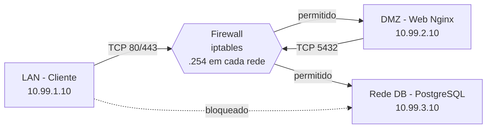

# Firewall Linux: Arquitetura Netfilter & iptables em Ambiente Segmentado

**Instituto Federal Goiano — Campus Ceres | Bacharelado em Sistemas de Informação**
**Disciplina:** Segurança da Informação — **Docente:** Prof. Roitier Campos Gonçalves
**Aluno:** Felipe — **Data:** 15/10/2026
**Repositório:** https://github.com/FelipeFire18/Trabalho-Parcial---Seguran-a-de-Redes.git

---

## 1. Definição do Case

**Cenário (hipotético, baseado em realidade):** uma instituição de ensino de médio porte mantém um **Portal Acadêmico** (consulta de notas, matrícula, comunicados) usado por alunos, professores e secretaria. O sistema é composto por:

- **Servidor web (Nginx)** que publica o portal;
- **Banco de dados PostgreSQL** com dados pessoais e acadêmicos dos alunos (sujeitos à LGPD);
- **Estações da rede interna** (laboratórios, biblioteca, secretaria).

**Contexto de negócio:** as estações precisam acessar o portal (HTTP/HTTPS), mas **somente o servidor web** pode falar com o banco. Nenhuma máquina de laboratório deve alcançar o banco diretamente, pois alunos e visitantes têm acesso físico a esses equipamentos.

## 2. Diagnóstico: Cenário Atual vs. Proposta de Solução

### 2.1 Cenário atual (problemas mapeados)

| # | Problema | Risco |
|---|----------|-------|
| 1 | Rede **plana**: estações, web e banco no mesmo segmento | Qualquer estação comprometida alcança o banco |
| 2 | Banco de dados acessível por toda a rede interna (porta 5432) | Força bruta de credenciais, exfiltração de dados (LGPD) |
| 3 | Ausência de controle de acesso entre segmentos | Varreduras (nmap) e movimentação lateral sem barreiras |
| 4 | Sem registro (log) de tentativas negadas | Incidentes não detectados nem auditáveis |
| 5 | Servidor web e banco sem separação de função | Comprometimento do web expõe o banco com facilidade |

### 2.2 Proposta de solução

Arquitetura em **três zonas** conectadas por um **firewall Linux (Netfilter/iptables)** que atua como único roteador:



**Justificativas:**

- **DMZ:** o servidor web é o componente mais exposto; isolá-lo limita o impacto de um comprometimento.
- **Rede de banco separada:** o dado sensível fica atrás de duas barreiras e só aceita conexão do servidor web.
- **Política DROP por padrão (*default deny*):** só trafega o que foi explicitamente justificado (princípio do menor privilégio).
- **Inspeção com estado (conntrack):** respostas de conexões legítimas são aceitas; conexões novas em sentido proibido (DMZ→LAN) são negadas.
- **Logs (`LOG`) com limitação de taxa:** auditoria sem permitir *log flooding*.
- **Redes Docker `internal: true`:** os segmentos não têm saída para a internet, reforçando o isolamento. As redes só se comunicam através do container firewall (as rotas estáticas dos clientes apontam para ele).

### 2.3 Componentes do ambiente (Docker Compose)

| Container | Rede | IP | Observação |
|-----------|------|----|------------|
| `lan-client` | lan 10.99.1.0/24 | 10.99.1.10 | Alpine + curl, nmap, psql, nc |
| `firewall` | lan, dmz, db | 10.99.1.254 / 10.99.2.254 / 10.99.3.254 | `cap_add: NET_ADMIN`, `ip_forward=1` |
| `dmz-web` | dmz 10.99.2.0/24 | 10.99.2.10 | Nginx |
| `dmz-db` | db 10.99.3.0/24 | 10.99.3.10 | PostgreSQL 16 |

Pontos técnicos:

- O firewall tem `NET_ADMIN` e `sysctls: net.ipv4.ip_forward=1` (encaminhamento de pacotes).
- `lan-client` e `dmz-web` recebem `NET_ADMIN` **apenas** para criar rotas estáticas via firewall em seus *entrypoints*.
- O banco não possui rota para a DMZ; o firewall aplica **MASQUERADE** nos pacotes destinados à rede do banco, de modo que o PostgreSQL responde ao próprio firewall.
- As regras são carregadas automaticamente por `firewall/entrypoint.sh` na subida do container.

## 3. Matriz de Regras de Segurança (Firewall)

**Política padrão:** `INPUT DROP`, `FORWARD DROP`, `OUTPUT ACCEPT`.

| # | Chain | Origem | Destino | Porta/Protocolo | Ação | Justificativa do negócio |
|---|-------|--------|---------|-----------------|------|--------------------------|
| 0 | FORWARD | Qualquer | Qualquer | ESTABLISHED,RELATED | ACCEPT | Permitir respostas de conexões já autorizadas |
| 0b | FORWARD | Qualquer | Qualquer | Estado INVALID | DROP | Descartar pacotes malformados/fora de estado |
| 1 | FORWARD | Rede Cliente (LAN) | DMZ (Web) | TCP 80, 443 | **ACCEPT** | Acesso ao portal acadêmico |
| 2 | FORWARD | Rede Cliente (LAN) | DMZ (Web) | ICMP echo-request | **ACCEPT** | Diagnóstico de conectividade pela TI |
| 3 | FORWARD | DMZ (Web) | Rede DB | TCP 5432 | **ACCEPT** | Portal consulta o banco; único caminho até os dados |
| 4 | FORWARD | Rede Cliente (LAN) | Rede DB | Qualquer | **DROP + LOG** | Cliente não deve acessar o banco direto |
| 5 | FORWARD | DMZ | LAN | Novas conexões | **DROP + LOG** | Servidor exposto não deve iniciar conexões à rede interna |
| 6 | FORWARD | Rede DB | LAN | Novas conexões | **DROP + LOG** | Banco não inicia conexões |
| 7 | FORWARD | Qualquer | Qualquer | Demais | **DROP + LOG** (política) | *Default deny* |
| 8 | INPUT | Qualquer | Firewall | ICMP echo (limitado) | ACCEPT | Teste de disponibilidade do gateway |
| 9 | INPUT | Qualquer | Firewall | Demais | DROP + LOG | Firewall não expõe serviços |
| 10 | NAT/POSTROUTING | Qualquer | Rede DB | — | MASQUERADE | Banco responde ao firewall (sem rota de retorno) |

Na regra 1, a porta 443 é liberada no firewall; como o Nginx do laboratório não escuta em 443, o teste retorna *closed* (e não *filtered*).

## 4. Metodologia de Testes e Validação

### 4.1 Preparação

```bash
git clone <URL_DO_REPOSITORIO> && cd seginf-firewall
docker compose up -d --build
docker compose logs firewall        # confirma as regras carregadas
docker compose exec firewall iptables -L -n -v --line-numbers
```

### 4.2 Testes positivos (devem funcionar)

| Teste | Comando | Resultado esperado |
|-------|---------|--------------------|
| LAN → Web (HTTP) | `docker compose exec client curl -i http://dmz-web` | `HTTP/1.1 200 OK` e página do portal |
| LAN → Web (ping) | `docker compose exec client ping -c 2 dmz-web` | Respostas recebidas |
| Web → Banco | `docker compose exec web nc -zv dmz-db 5432` | Porta aberta (`open`) |

### 4.3 Testes negativos (devem ser bloqueados)

| Teste | Comando | Resultado esperado |
|-------|---------|--------------------|
| LAN → Banco (TCP) | `docker compose exec client nc -zv -w 3 dmz-db 5432` | Timeout / falha |
| LAN → Banco (cliente SQL) | `docker compose exec client psql -h dmz-db -U portal` | Timeout |
| Varredura ao banco | `docker compose exec client nmap -Pn -p 5432 dmz-db` | Porta `filtered` |
| Varredura ao web | `docker compose exec client nmap -Pn -p 22,80,443 dmz-web` | 80 `open`; 22 `filtered`; 443 `closed` |
| LAN → Banco (ping) | `docker compose exec client ping -c 1 -W 2 dmz-db` | 100% de perda |
| DMZ → LAN | `docker compose exec web ping -c 1 -W 2 10.99.1.10` | 100% de perda |

### 4.4 Execução automatizada e evidências

```bash
./test.sh
```
O script executa todos os testes acima e imprime `[OK]`/`[FAIL]`. Para ver os contadores de pacotes descartados:

```bash
docker compose exec firewall iptables -L FORWARD -n -v --line-numbers
dmesg | grep FW-DROP        # no host Linux
```


## 5. Conclusão

A segmentação em LAN, DMZ e rede de banco, combinada à política *default deny* do Netfilter/iptables, reduz a superfície de ataque do portal: o banco só é alcançável a partir do servidor web, as estações internas só enxergam HTTP/HTTPS, e as tentativas negadas ficam registradas. Como melhorias futuras: TLS no Nginx, `nftables`, IDS (Suricata/Snort), regras de *rate limit* contra varredura e `fail2ban`.

## Referências

- Netfilter Project. *iptables / nftables documentation.* https://www.netfilter.org
- Docker Docs. *Networking overview; Compose file reference.* https://docs.docker.com
- Brasil. Lei nº 13.709/2018 (LGPD).
